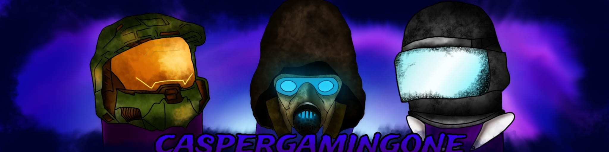
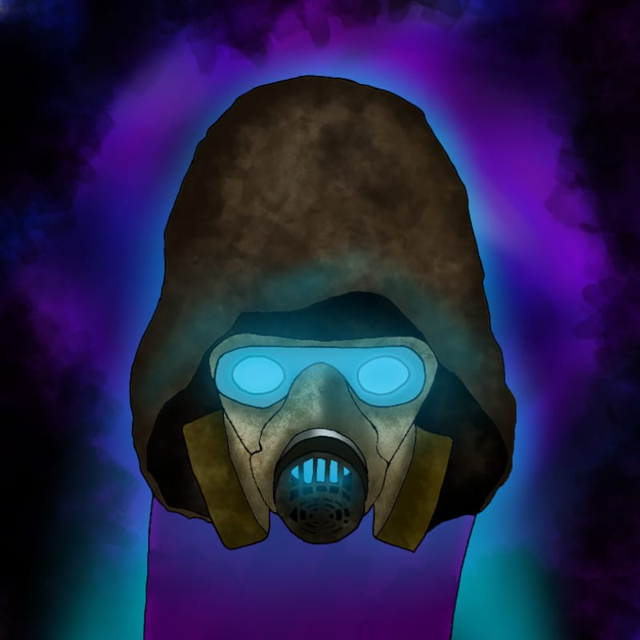
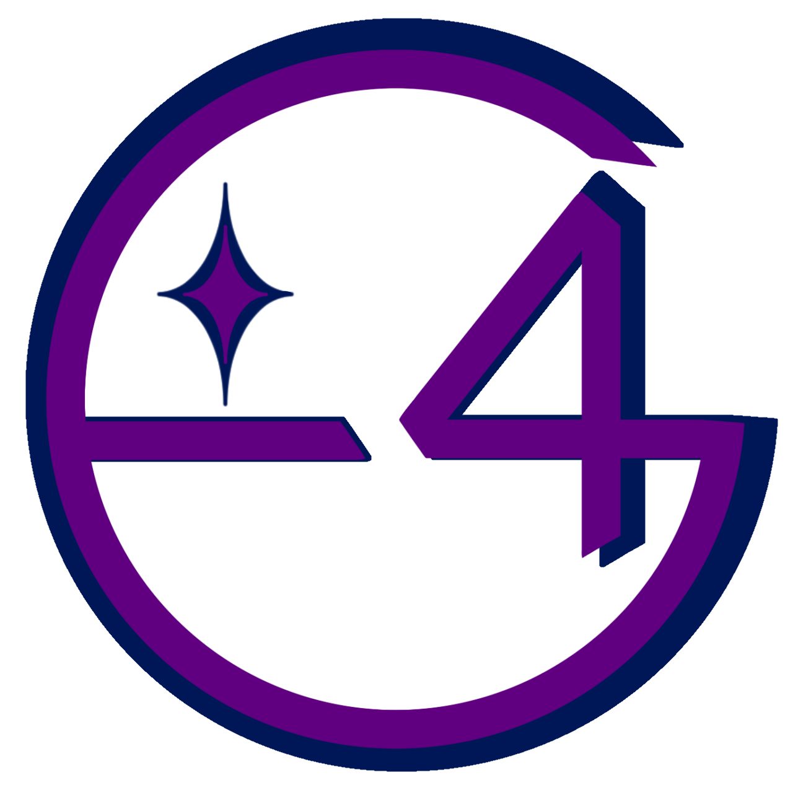

<p align="center">
  
</p>

<p align="center">
  
  &nbsp;&nbsp;&nbsp;&nbsp;
  
</p>

# cgo-void-repo 🐧

Personal XBPS binary package repository for **Void Linux**, maintained by **CasperGamingOne** under the **Games4Everyone** project. Features continuous rolling releases with dual-channel architecture: standard baseline and native **x86_64-v3 microarchitecture performance optimizations**.

🌐 **Website & Portal:** [https://caspergamingone.github.io/cgo-void-repo](https://caspergamingone.github.io/cgo-void-repo)  
📥 **Package Request Form:** [Submit a Request](https://caspergamingone.github.io/cgo-void-repo#request)

---

## ⚡ Dual-Channel Release Architecture

`cgo-void-repo` uses clean package names (`noctalia`, `umbriel`, `vmware-workstation`, etc.) distributed across two distinct GitHub Release channels:

| Channel Tag | Target Architecture | Compiler Optimization | Recommended For |
|---|---|---|---|
| **`rolling-v3`** | `x86_64-v3` | `-O3 -march=x86-64-v3 -pipe` (AVX2, FMA, BMI1/2) | Intel Haswell (2013+), AMD Zen (2017+) or newer |
| **`rolling`** | `x86_64` | `-O2 -pipe` (Universal Baseline) | All 64-bit x86 CPUs, Hypervisors, Virtual Machines |

> [!TIP]
> Both channels are completely self-contained. Packages that cannot be compiled from source (e.g. VMware, MegaSync, Google Antigravity) are automatically mirrored into both channels so you can configure whichever channel suits your machine.

---

## 🔍 Check Your CPU Microarchitecture

To verify if your processor supports the optimized `x86_64-v3` channel, run this command in your Void Linux terminal:

```bash
/lib/ld-linux-x86-64.so.2 --help | grep -E "x86-64-v[234]"
```

* If you see **`x86-64-v3 (supported, searched)`**, your CPU is ready for **`rolling-v3`**!
* If only `x86-64` or `x86-64-v2` is supported, use the baseline **`rolling`** channel.

---

## 🚀 Quick Setup for Clients

### Option A: Modern Processors (`x86_64-v3` Optimized - Recommended)

```bash
# 1. Download and trust the repository RSA signing key
sudo wget -O /var/db/xbps/keys/cgo-void-repo.pem https://caspergamingone.github.io/cgo-void-repo/cgo-void-repo.pem

# 2. Add x86_64-v3 repository channel
echo "repository=https://github.com/CasperGamingOne/cgo-void-repo/releases/download/rolling-v3" | sudo tee /etc/xbps.d/10-cgo-void-repo.conf

# 3. Synchronize repository index and install
sudo xbps-install -S
sudo xbps-install -S noctalia umbriel vmware-workstation megasync
```

### Option B: Universal Compatibility (`x86_64` Baseline)

```bash
# 1. Download and trust the repository RSA signing key
sudo wget -O /var/db/xbps/keys/cgo-void-repo.pem https://caspergamingone.github.io/cgo-void-repo/cgo-void-repo.pem

# 2. Add baseline repository channel
echo "repository=https://github.com/CasperGamingOne/cgo-void-repo/releases/download/rolling" | sudo tee /etc/xbps.d/10-cgo-void-repo.conf

# 3. Synchronize repository index and install
sudo xbps-install -S
```

---

## 📦 Available Packages

| Package | Version | Channel Availability | License | Description |
|---|---|---|---|---|
| **`antigravity`** | `2.28.2_1` | 🌐 Universal | `custom:Google-Antigravity` | Google Antigravity 2.0 multi-agent orchestration platform |
| **`antigravity-ide`** | `2.6.0_1` | 🌐 Universal | `custom:Google-Antigravity` | Google Antigravity agent-first AI integrated development environment |
| **`cgo-hello`** | `1.0.0_1` | 🌐 Universal | `MIT` | Welcome verification package |
| **`megasync`** | `6.7.0_1` | 🌐 Universal | `custom:MEGA LIMITED CODE LICENCE` | Easy automated syncing for MEGA cloud drive |
| **`noctalia`** | `5.4.1_1` | ⚡ `rolling-v3` & 📦 `rolling` | `MIT` | Sleek, customizable Wayland desktop shell |
| **`noctalia-greeter`** | `1.7.0_1` | ⚡ `rolling-v3` & 📦 `rolling` | `MIT` | Greeter for greetd based on Noctalia desktop shell |
| **`umbriel`** | `0.1.0_1` | ⚡ `rolling-v3` & 📦 `rolling` | `MIT` | Wayland compositor with effects built on wlroots 0.20 |
| **`vmware-workstation`** | `26H1u1_2` | 🌐 Universal | `custom:Proprietary` | Industry-standard virtualization workstation with DKMS & runit services |
| **`xdg-desktop-portal-umbriel`** | `0.1.0_1` | ⚡ `rolling-v3` & 📦 `rolling` | `MIT` | Desktop portal backend for Umbriel |

---

## ⚖️ Packaging Standards & License Compliance

All packages follow the [Void Linux Packaging Manual](https://github.com/void-linux/void-packages/blob/master/Manual.md):
- **Free Software (FOSS)**: Licensed under upstream terms (`MIT`) with complete license texts installed via `vlicense`.
- **Restricted Software**: Marked with `restricted=yes`, requiring acceptance of official vendor EULAs (VMware, Google Antigravity, MegaSync).
- **Quality Assurance**: Every template passes `xlint` with zero errors or warnings.
- **Clean System Integration**: Proprietary binaries are cleanly isolated under `/usr/lib/` or `/opt/`, system runit services are provided under `/etc/sv/`, and kernel drivers utilize official DKMS triggers.

---

## 📁 Repository Structure

```text
cgo-void-repo/
├── docs/                    # GitHub Pages interactive portal and JSON package feed
├── binpkgs/
│   ├── x86_64/              # Baseline generic packages (rolling release)
│   └── x86_64-v3/           # Microarchitecture-optimized packages (rolling-v3 release)
├── etc/xbps.d/              # Sample client configuration files
├── repo-keys/               # Public RSA verification keys
├── scripts/
│   ├── build-pkg.sh         # Modular builder with generic and --v3 support
│   ├── check-updates.py     # Upstream version and sha256 update monitor
│   ├── generate-web.py      # Website and packages.json generator
│   ├── notify-requester.py  # Discord DM bot notification pipeline
│   └── sign-repo.sh         # Cryptographic indexer and RSA signer
├── srcpkgs/                 # Void Linux package templates
└── .github/
    ├── workflows/           # CI/CD and automated issue notification workflows
    └── ISSUE_TEMPLATE/      # Structured package request forms
```

---

## 📄 License & Personal Branding

* **Packaging Code & Scripts**: Licensed under the [MIT License](LICENSE).
* **Personal Branding & Artworks**: Brand names (**CasperGamingOne**, **Games4Everyone**), logos, avatars, and banner artworks are exclusive personal creative assets and may not be reused or modified without prior written consent.
